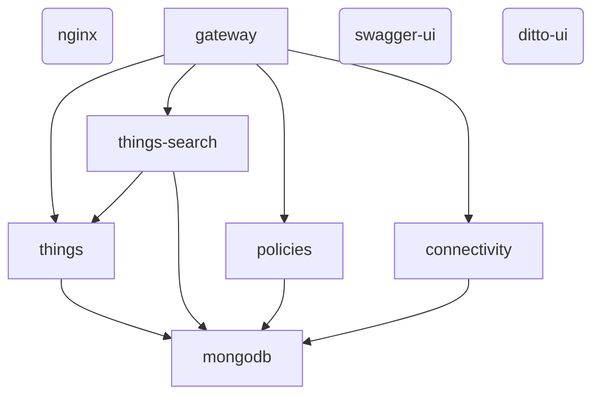
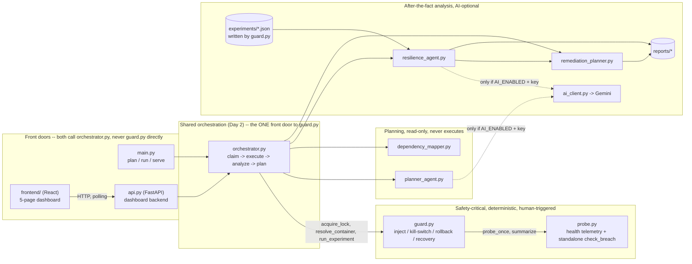
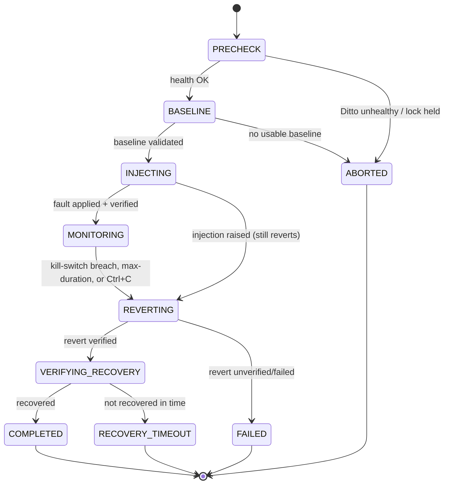
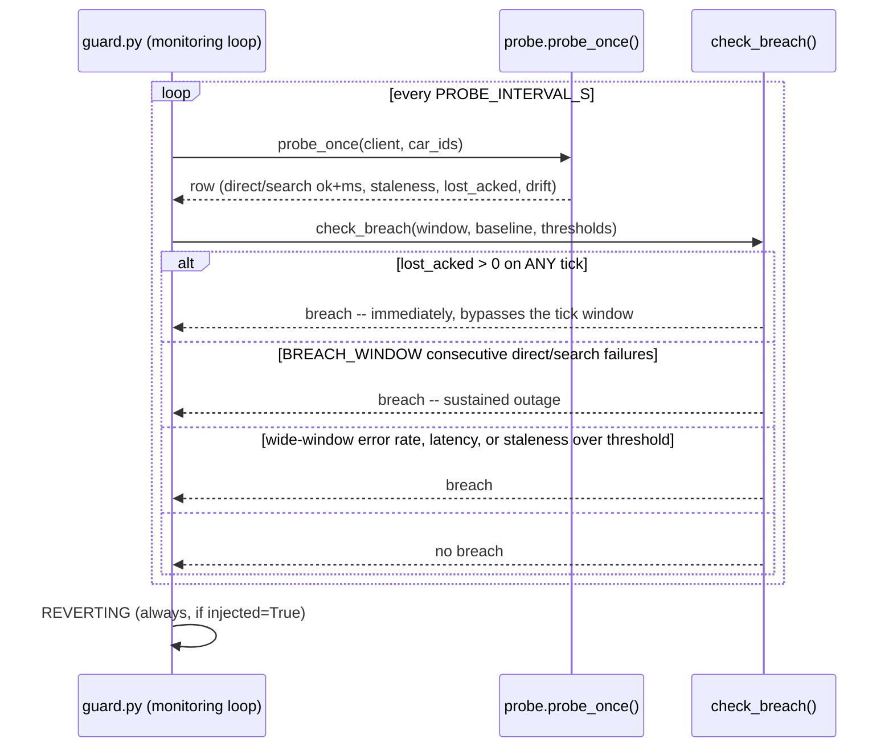
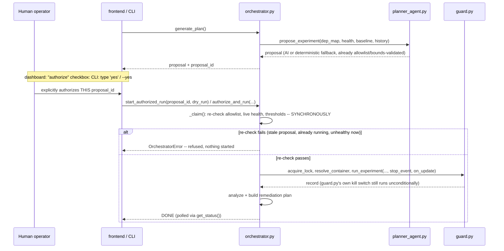

# Architecture

## System components (real, observed on this machine)

Square boxes = core Ditto backend services (in `guard.py`'s fault allowlist). Rounded = support/UI (nginx reverse proxy, swagger-ui docs, ditto-ui explorer) — not on the simulated fleet's data path, not allowlisted. This diagram is regenerated by `python main.py map` from the **actually running** containers plus Ditto's documented service architecture (see `dependency_mapper.py`'s `KNOWN_ARCHITECTURE_EDGES` for the exact, sourced claims) — it is not hand-drawn or guessed. `mongodb`'s fan-in of 4 is *calculated* from the edge list, not asserted.

## Tool architecture (this project's own code)

The arrows into `ai` are dashed and conditional: both `resilience_agent.py` and `planner_agent.py` call `ai_client.generate_json()`, which raises `AIUnavailable` for anything other than a validated success (disabled, no key, network error, bad HTTP status, unparseable/malformed JSON) — each caller always has a deterministic fallback path. **Nothing above `guard.py` in this diagram can touch Docker directly.** The only two ways a real fault gets injected are (a) a human running `guard.py` directly, or (b) `orchestrator.authorize_and_run()`/`start_authorized_run()`, which is only ever reached after a human has explicitly set `authorize: true` (dashboard) or typed `yes`/passed `--yes` (CLI) — see "The approval gate" below. An AI proposal from `planner_agent.py` can never reach `guard.py` on its own; it only ever produces a `dict` that a human then chooses to authorize or not.

## Experiment lifecycle (guard.py)

Key invariant, enforced in code (`run_experiment()`'s `try/except/finally`): once `record["injected"] = True` is set — **before** `fault.inject()` is even called — a revert is attempted no matter what happens next: a breach, a crash during monitoring, Ctrl+C, or an exception inside `inject()` itself. The record is *always* returned (never raised past this function), so a result is always saved.

## Kill-switch decision sequence

## The approval gate (Day 2: planner -> orchestrator)

Two things make this safe even with an AI in the loop: (1) `planner_agent.py`'s output is **re-validated twice** -- once inside the planner (rejecting anything outside `guard.ALLOWLIST` or outside this module's own param bounds) and once more inside `orchestrator._claim()` right before injection, because the proposal may be minutes old by the time a human acts on it; (2) `_claim()` is synchronous and runs to completion (or raises) before any Docker call happens, so a bad request gets an immediate, honest error instead of a background task that silently fails. `guard.py`'s own kill switch (`check_breach()`) is completely unaware any of this exists -- it runs exactly as it always has, whether invoked from `orchestrator.py` or directly from the `guard.py` CLI.

## Why two kill switches?

`guard.py` and `probe.py` each implement `check_breach()` — a deliberate non-merge, not an oversight.

| | `guard.py`'s check_breach | `probe.py`'s check_breach |
|---|---|---|
| Input | a growing list of per-tick rows it drove itself, in-process | one rolling-window summary read back from a file |
| Needs a second process running? | No | Yes — `python probe.py` must be running separately and writing `metrics/*.jsonl` |
| Policy | consecutive-tick outage detection + a longer-window rate signal | single-snapshot rate/latency/staleness thresholds |
| Used for | the actual kill switch during a real experiment | a standalone dashboard/CLI health check |

The practical reason to keep them separate: if `guard.py` depended on `probe.current_health()`, forgetting to start `python probe.py` in a second terminal would make `check_breach()` see no fresh data on *every* tick — the kill switch would refuse every experiment, or worse, behave unpredictably depending on stale leftover files. `guard.py` must work standalone. Both read the same threshold **values** from `config.py`/env vars, so they can't silently drift to different numbers even though the decision *logic* differs.

## Agents actually implemented vs. described-but-deferred

**Day 1** shipped the deterministic safety core (discovery, monitoring, fault injection, rollback, recovery) plus AI-optional after-the-fact analysis. **Day 2** (this section, updated) adds the planner agent, the shared orchestrator, the backend API, and the frontend dashboard — all built as a layer *on top of* Day 1's code, with zero changes to `guard.py`'s or `probe.py`'s safety-critical decision logic (`check_breach`, `is_healthy`, the allowlist). The only changes inside `guard.py` itself are two optional, additive parameters on `run_experiment()` (`stop_event`, `on_update`), both defaulting to `None` with behavior identical to before they existed — see the regression tests added alongside them in `test_guard.py`.

| Agent (from the brief) | Status | Where |
|---|---|---|
| 1. Discovery / dependency mapping | **Implemented**, deterministic, no AI | `dependency_mapper.py` |
| 2. AI experiment planner (proposes fault+params via LLM) | **Implemented**, AI-optional with a deterministic fallback; output is allowlist/bounds-validated before it can ever reach the orchestrator | `planner_agent.py` |
| 3. Health monitoring | **Implemented**, pre-existing + extended | `probe.py` |
| 4. Safety supervisor / kill switch | **Implemented**, deterministic, two independent policies; re-validated again by `orchestrator._claim()` immediately before every authorized run | `guard.py`, `probe.py`, `orchestrator.py` |
| 5. Fault injection | **Implemented**, with verified rollback | `guard.py` |
| 6. Recovery | **Implemented** (guard.py's own revert+verify+recovery-measurement) | `guard.py` |
| 7. AI analyst / root-cause | **Implemented**, AI-optional with deterministic fallback | `resilience_agent.py` |
| 8. Autonomous orchestrator (plan -> safety-approve -> inject -> ... loop) | **Implemented, with one deliberate difference from "autonomous": the approval step is not automatable.** The orchestrator automates everything AROUND the human decision (planning, allowlist re-validation, injection, rollback, recovery verification, analysis, remediation planning) but `authorize: true` must come from an operator action every single time — see "The approval gate" above and the Day 1 incident log for why this line stays put. | `orchestrator.py`, `api.py`, `main.py` |
| Remediation classification (A/B/C) | **Implemented**: classification + plan, decision tracking (approve/reject), live before/after health verification | `remediation_planner.py`, `orchestrator.py` |
| Category B/C auto-remediation (applying a fix automatically) | **Still not implemented** — allowlist is intentionally empty | `remediation_planner.py` |
| Fix-and-retest comparison loop | **Partially implemented**: `orchestrator.verify_remediation()` re-checks live health against the experiment's baseline on demand; there is no automatic "apply fix, re-run the same experiment, diff the results" loop | `orchestrator.py` |
| Live dashboard | **Implemented**: 5-page React dashboard polling the real backend | `frontend/` |

**Why the approval gate stays manual, stated plainly:** during Day 1's own development, a deterministic bug (not even an AI mistake) caused a real `docker kill` to run against a live container with no sandbox isolation, and a second deterministic bug then blocked the automatic revert. Both were caught and fixed within the same session, but it's a concrete demonstration of how much can go wrong even in code written carefully and reviewed closely. Letting an LLM (or a heuristic) *execute* a fault with no human in the loop is a materially different risk profile from letting it *propose* one — Day 2 automates the planning, execution plumbing, and analysis, and draws the line at that one click/typed `yes`, exactly where the master brief itself requires it ("real fault injection must require explicit operator authorization, even when the planner is autonomous").

**Why Category B/C auto-remediation is still not implemented:** the allowlist in `remediation_planner.py` is still intentionally empty, for the same reason it was on Day 1 — no specific, reversible, verifiable auto-apply path has been designed and tested yet, and adding one casually is exactly the kind of same-day scope creep that caused Day 1's incident. `orchestrator.decide_remediation()` records an operator's approve/reject decision for the audit trail; it never mutates a container, config file, or Compose service.

## Known limitations

See the README's "Safety limitations" section — it's the single source of truth for this, kept next to the setup instructions where it'll actually be read.
