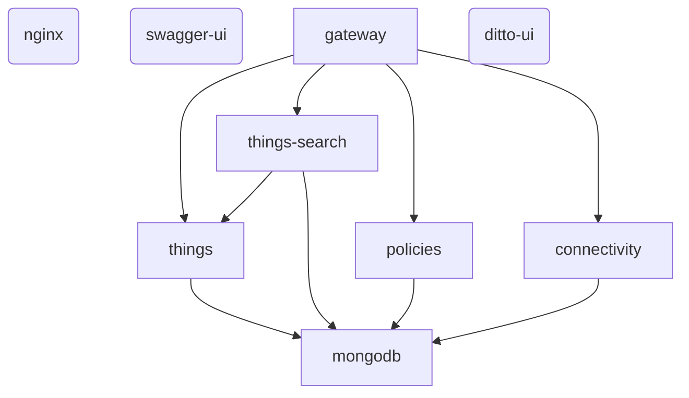

# Dependency map (auto-generated, deterministic -- no AI)

Generated: 2026-10-10T08:34:05+00:00  
Compose project: `docker`

## Observed containers

| service | container | image | state | role | fault-allowlisted |
|---|---|---|---|---|---|
| nginx | docker-nginx-1 | nginx:1.27-alpine | running | support/ui | no |
| swagger-ui | docker-swagger-ui-1 | swaggerapi/swagger-ui:v5.9.1 | running | support/ui | no |
| gateway | docker-gateway-1 | eclipse/ditto-gateway:latest | running | core-ditto-backend | yes |
| things-search | docker-things-search-1 | eclipse/ditto-things-search:latest | running | core-ditto-backend | yes |
| things | docker-things-1 | eclipse/ditto-things:latest | running | core-ditto-backend | yes |
| connectivity | docker-connectivity-1 | eclipse/ditto-connectivity:latest | running | core-ditto-backend | yes |
| mongodb | docker-mongodb-1 | mongo:7.0 | running | core-ditto-backend | yes |
| ditto-ui | docker-ditto-ui-1 | eclipse/ditto-ui:latest | running | support/ui | no |
| policies | docker-policies-1 | eclipse/ditto-policies:latest | running | core-ditto-backend | yes |

## Dependency edges

| from | to | source | both ends observed running | note |
|---|---|---|---|---|
| gateway | things | known-architecture | yes | gateway routes thing CRUD requests to the things service |
| gateway | things-search | known-architecture | yes | gateway routes search queries to the things-search service |
| gateway | policies | known-architecture | yes | gateway routes policy requests to the policies service |
| gateway | connectivity | known-architecture | yes | gateway routes connection-management requests to connectivity |
| things | mongodb | known-architecture | yes | things persists digital-twin state to MongoDB |
| things-search | mongodb | known-architecture | yes | things-search persists its search index to MongoDB |
| policies | mongodb | known-architecture | yes | policies persists authorization policies to MongoDB |
| connectivity | mongodb | known-architecture | yes | connectivity persists connection configuration to MongoDB |
| things-search | things | known-architecture | yes | things-search consumes change events from things to stay in sync |

## Fault-target recommendations (risk calculated from fan-in, not asserted)

| service | fan-in | fan-out | calculated risk | allowlisted | reasoning |
|---|---|---|---|---|---|
| connectivity | 1 | 1 | medium | yes | 1 other service(s) depend on it |
| ditto-ui | 0 | 0 | low | no | nothing in the known architecture depends on it directly; NOT in guard.py's ALLOWLIST -- guard.py will refuse to target it |
| gateway | 0 | 4 | low | yes | nothing in the known architecture depends on it directly |
| mongodb | 4 | 0 | high | yes | 4 other services depend on it (highest fan-in in this deployment) |
| nginx | 0 | 0 | low | no | nothing in the known architecture depends on it directly; NOT in guard.py's ALLOWLIST -- guard.py will refuse to target it |
| policies | 1 | 1 | medium | yes | 1 other service(s) depend on it |
| swagger-ui | 0 | 0 | low | no | nothing in the known architecture depends on it directly; NOT in guard.py's ALLOWLIST -- guard.py will refuse to target it |
| things | 2 | 1 | medium | yes | 2 other service(s) depend on it |
| things-search | 1 | 2 | medium | yes | 1 other service(s) depend on it |

## Diagram

Solid arrows = known Ditto architecture (from Ditto's own docs). Dashed/labeled arrows = manual overrides from overrides.yaml, if any.
